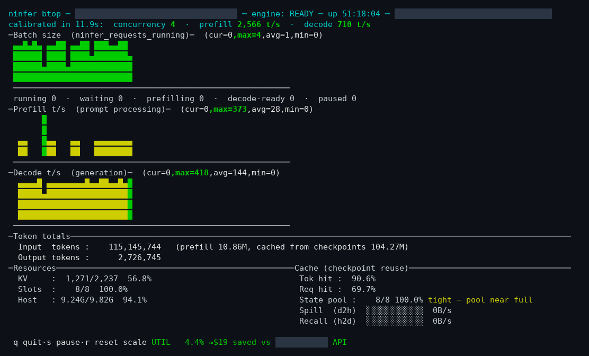

# ninfer_btop

A btop-style live dashboard for a [NInfer](https://github.com/Neroued/ninfer) inference engine.



Polls the engine's Prometheus `/metrics` endpoint and renders:

- scrolling bar graph: **batch size** (`ninfer_requests_running`)
- scrolling bar graph: **prefill t/s** (inter-poll rate of `ninfer_prefill_tokens_total` —
  prompt processing). While a request is prefilling, decode t/s is correctly 0 and the prefill
  graph shows the work; both rates drop to 0 as soon as the engine is idle.
- scrolling bar graph: **decode t/s** (inter-poll rate of `ninfer_generation_tokens_total`)
  (The engine publishes stats after every prefill/decode step, so both track live phase.)
- token totals: input (prompt) / output (generation)
- Resources ∥ Cache (checkpoint reuse) — two panels side by side: one shared
  title row ("Resources" left, "Cache (checkpoint reuse)" right) plus 5
  content rows. Left = KV pool / state slots / host context gauges. Right =
  "Tok hit" (token-level input hit: `ninfer_prompt_tokens_cached_total` ÷
  `ninfer_prompt_tokens_total`) and "Req hit" (request-level hit:
  `ninfer_checkpoint_selections_total` ÷ checkpoint+root selections) ratios,
  "State pool" pressure (device state slots used ÷ capacity), a colored pool
  verdict (green "ok" / yellow "tight" / red "TOO SMALL — raise
  --device-state-slots" / dim "n/a"), and two context-transfer bars on one
  shared scale: "Spill (d2h)" (device→host) vs "Recall (h2d)" (host→device),
  read per-direction from `ninfer_context_transfer_bytes_total`
  (`direction="d2h"` / `"h2d"`), so host-tier shedding vs re-use is visible
  at a glance.
- request lanes: running / waiting / prefilling / decode-ready / paused
  (one row under the batch graph)

Standard library only (curses + urllib). Nothing to install.

## Usage

```
python3 ninfer_btop.py --url URL [-i INTERVAL_MS] [--text] [--no-calib]
    [--burst N] [--pricing-model KEY] [--pricing-file PATH]
```

- `--url`   metrics endpoint (required)
- `-i`      poll interval in ms (default 500)
- `--text`  one-shot plain-text stats, no TUI
- `--no-calib`  skip the startup benchmark (utilization shows n/a)
- `--burst N`   parallel requests for the calibration burst (default 8)
- `--pricing-model KEY`  cloud-API pricing row to use — a model key from `pricing.yaml` (default `qwen3.8-27b`)
- `--pricing-file PATH`  use a different pricing YAML file (default: `pricing.yaml` next to the script)

Keys in TUI mode: `q`/Esc quit · `s` pause/resume polling · `r` reset graph auto-scale.
The app ignores SIGTTOU, so it also works as a background job.

## Startup calibration & utilization

On startup (TUI and `--text` alike, unless `--no-calib`) the script benchmarks the
engine (tens of seconds, depending on engine load — 74 s on the default engine):

1. **prefill** — one large uncached prompt; `max prefill t/s` = prefill tokens ÷ time to
   first generated token
2. **decode** — `--burst` parallel requests; `max decode t/s` = peak inter-sample rate of
   `ninfer_generation_tokens_total`, and `max concurrency` = peak of `ninfer_requests_running`

The results are shown on row 1 of the UI (the three max values are highlighted).
Utilization is shown live only in the footer: ` UTIL 2.6%  ≈$11 saved vs qwen3.8-27b Cloud API ` (the label is the selected `--pricing-model` key).

    UTIL = (prefill time + decode time) / uptime

where prefill/decode *time* is estimated as lifetime `ninfer_prefill_tokens_total` ÷ max
prefill t/s plus lifetime `ninfer_generation_tokens_total` ÷ max decode t/s, and uptime is
`now - ninfer_server_start_time_seconds`. It is recomputed every poll, so it creeps up
while the engine is busy. Notes:

- it is an **underestimate**: cached (checkpoint) prompt tokens and time spent below max
  rate are not counted
- on a **shared engine**, calibration and lifetime figures include other users' traffic,
  and a busy box during calibration measures rates lower than a quiet one would


## Cost savings vs the cloud API

The footer and `--text` output also show lifetime **money saved** vs sending the same
tokens through the official cloud API **for this model** (rates verified against the
provider's published price list):

    input $0.50/M   output $3.00/M   cache-hit input $0.05/M (10% of input rate)

    saved = (new input · $0.50 + cached input · $0.05 + output · $3.00) / 1M

Token counts are the lifetime `ninfer_prompt_tokens_total` /
`ninfer_generation_tokens_total` counters; the new-vs-cached input split comes from
`ninfer_prompt_tokens_cached_total`. Self-hosting is assumed to cost ≈ $0 (power and
hardware are not deducted). To switch models or add your own pricing, pass
`--pricing-model <key>` to pick a row from `pricing.yaml`, or edit `pricing.yaml`
(next to the script) to add rows — one model key per entry, each mapping to
`input` / `cached_input` / `output` rates in $/M.


## How it compares

Prior-art scan (2026-10-14): a young niche of LLM-engine TUIs appeared in
2025–26 (llm-visuals, toptop, LLMtop, ktop, tokentop, toktop — mostly Rust),
and a few NInfer-specific monitors exist (the [fusion-kvmem
fork](https://github.com/1314521gjy/ninfer-fusion-kvmem)'s web dashboard +
watchdog, speculum, CookLLM) — all web/GUI. The mainstream approach in the
space is Prometheus `/metrics` + Grafana (vLLM, TGI, and SGLang all ship
official dashboard JSON in-repo; llama.cpp/Ollama have community dashboards
only). Upstream NInfer documents `/metrics` and `/stats` but ships no monitor.
The closest single analog is [llm-visuals](https://github.com/DingoOz/llm-visuals)
(147★, very active), which has a dedicated NInfer adapter.

Against all of these, the features that are unique to ninfer_btop:

- **cost-savings footer** — lifetime $ saved vs this model's cloud API;
  no known tool combines live token rates + utilization + a
  cost comparison
- **in-dashboard startup calibration** — max prefill/decode rates are
  benchmarked by the dashboard itself on startup, rather than sourced from a
  separate benchmark tool
- **utilization as a headline gauge** — busy time ÷ uptime, recomputed every
  poll and shown live in the footer next to the cost line
- **the only NInfer-specific curses TUI** — every other NInfer monitor is
  web or GUI-based


## Verified against

NInfer upstream `Neroued/ninfer` @ `81c8ce0` (2026-10-07): `/metrics` renders
`published_stats_`, which the engine worker republishes after every decode/prefill step
(`engine_core.h` → `publish_runtime_stats()`), so the counters are real-time and a
between-polls rate is the correct tokens/s signal.

## TODO

- **Cumulative stats reset when the engine restarts** (verified in upstream
  `Neroued/ninfer` @ `81c8ce0`). The `/metrics` lifetime counters are rendered as
  `current - baseline`: `current` is an in-memory `RuntimeStats cumulative_stats_`
  accumulator in the engine worker that is only ever incremented (`+=`/`++`) and is
  **never persisted to disk** (`types.h`, `engine_core.h`, `engine_metrics.inl`);
  `baseline` is a snapshot taken once by `Metrics::configure()` from
  `HttpServer::attach()` after warmup, and `ninfer_server_start_time_seconds` is
  stamped at the same attach. So after any engine (process) restart the token
  totals, the "≈$ saved vs API" figure, and `UTIL` / `up X` (all derived from those
  counters plus the start-time gauge) fall back to ≈0, and ninfer_btop — which
  sources every one of them from `/metrics` — inherits the reset.
  - Fix direction: have ninfer_btop accumulate its own inter-poll deltas into a
    session-lifetime total (detecting a rollover when a new counter reading is lower
    than the last) so its lifetime tokens / $ survive an engine restart, or tail the
    engine's `--request-log-jsonl` for a durable per-request record.

## Donations

ninfer_btop is free and open source, built in my spare time. If you find it useful and
you'd like to support it, I happily accept crypto — but it's entirely optional and there's
no pressure:

| Bitcoin | Ethereum | Dogecoin |
|:-------:|:--------:|:--------:|
|  |  |  |

---

_I love ninfer enough to spend a few dollar worth of tokens to make this tool._
