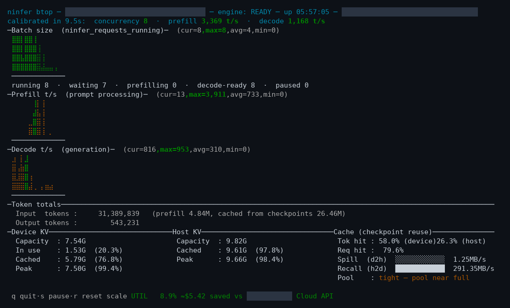

# ninfer_btop

A btop-style live dashboard for a [NInfer](https://github.com/Neroued/ninfer) inference engine.



Polls the engine's Prometheus `/metrics` endpoint and renders:

- scrolling bar graph: **batch size** (`ninfer_requests_running`). The panel's height follows
  the engine's max concurrency: one braille character resolves 4 dot levels (4 concurrent
  requests), so the graph is ceil(max_concurrency / 4) characters high. Its scale is pinned
  to max_concurrency — one dot level is always exactly one request, the window max never
  stretches the scale, and overload clips at the top — at ninfer's cap of 8 the panel is
  1 or 2 characters high.
- scrolling bar graph: **prefill t/s** (inter-poll rate of `ninfer_prefill_tokens_total` —
  prompt processing). While a request is prefilling, decode t/s is correctly 0 and the prefill
  graph shows the work; both rates drop to 0 as soon as the engine is idle.
- scrolling bar graph: **decode t/s** (inter-poll rate of `ninfer_generation_tokens_total`)
  (The engine publishes stats after every prefill/decode step, so both track live phase.)
  The graphs scroll left to right (the newest sample enters at the left edge and bars
  exit on the right — deliberately unlike btop). Each braille character holds exactly
  one sample, drawn as a flat column of dots (never a rising/falling glyph), so each
  poll shifts a graph by exactly one character — the motion can never jump.
- token totals: input (prompt) / output (generation)
- Device KV ∥ Host KV ∥ Cache (checkpoint reuse) — three panels side by side
  on one shared title row plus 4 content rows (btop-style). The two KV
  columns read the engine's unified context pool per domain (engine ≥
  2026-10-23 state/KV unification): Device KV = capacity / in use / cached /
  lifetime peak bytes, Host KV = capacity / cached / lifetime peak bytes
  (`ninfer_context_pool_{bytes,live_bytes,peak_bytes}`, summed over ranks;
  pre-unification engine builds show "n/a" per row). The cache panel shows
  "Tok hit" (token-level input hit: `ninfer_prompt_tokens_cached_total` ÷
  `ninfer_prompt_tokens_total`); when bytes-per-token is known via `--bytes-per-tok` (see
  `bytes_per_token.md`), the
  figure is split by serving tier — `xx% (device)xx% (host)` — an
  approximation: lifetime host→device recall bytes ÷ bytes-per-token ~ the
  cached tokens that had to be recalled from host RAM, the remainder was
  served in place from VRAM. On hybrid models (Qwen3.8-27B: 16 of 64 layers
  store per-token KV; the GDN layers carry fixed per-request state), only
  the full-attention layers contribute: `layers_fa x 2 x kv_heads x
  (head_dim + scale overhead)` — e.g. 16 x 2 x 4 x 264 = 33,792 B/tok for
  INT8 group-64 KV (fp16 scale per 64-element group), 33,024 for FP8 e4m3
  group-128) and "Req hit" (request-level hit:
  `ninfer_checkpoint_selections_total` ÷ checkpoint+root selections) ratios,
  plus two braille sparklines for context transfers: "Spill (d2h)" (device→host) and
  "Recall (h2d)" (host→device), read per-direction from
  `ninfer_context_transfer_bytes_total` (`direction="d2h"` / `"h2d"`). Each
  sparkline keeps ~6.5 s of history, autoscales to its own window peak
  (shown as the side label for scale), and uses the same braille dots as the
  main graphs — so a few-millisecond recall burst that a one-poll bar would
  miss stays visible for the whole window, and host-tier shedding vs re-use
  is visible at a glance.
- request lanes: running / waiting / prefilling / decode-ready / paused
  (one row under the batch graph; the paused figure is red whenever
  non-zero — a paused request is a live request stalled on a capacity
  event, the one lane number that signals a problem)

Standard library only (curses + urllib). Nothing to install.

## Usage

```
python3 ninfer_btop.py --url URL [-i INTERVAL_MS] [--text] [--re-calib]
    [--burst N] [--bytes-per-tok N] [--pricing-model KEY] [--pricing-file PATH]
```

- `--url`   metrics endpoint (required)
- `-i`      poll interval in ms (default 500); each poll shifts the bar graphs by
  exactly one character
- `--text`  one-shot plain-text stats, no TUI
- `--re-calib`  drop the `~/.ninfer_btop.json` calibration cache and re-run the
  startup benchmark (by default the cache is reused while the engine's start time
  is unchanged — a restarted engine re-benchmarks automatically)
- `--bytes-per-tok N`  exact context bytes per token for the device/host hit
  split, computed from the model architecture: full-attention layers x 2
  (K+V) x kv_heads x (head_dim x dtype_bytes + scale overhead) — INT8
  group-64 stores 1 B/element plus an fp16 scale per 64-element group
  (256+8 = 264 B for a 256-dim head), FP8 e4m3 group-128 1 B/element plus a
  1 B power-of-two scale per 128-element group (256+2 = 258 B) — plus the
  MTP draft layer if its KV is pooled. Hybrid models count only their
  full-attention layers. Without the flag the tier split is off and the Tok
  hit line shows the combined figure; the value is exact for the model +
  KV dtype and never saturates like a measured estimate would
- `--burst N`   parallel requests for the calibration burst (default 8)
- `--pricing-model KEY`  cloud-API pricing row to use — a model key from `pricing.yaml` (default `qwen3.8-27b`)
- `--pricing-file PATH`  use a different pricing YAML file (default: `pricing.yaml` next to the script)

Keys in TUI mode: `q`/Esc quit.
The app ignores SIGTTOU, so it also works as a background job.

## Startup calibration & utilization

On startup (TUI and `--text` alike) the script benchmarks the
engine (tens of seconds, depending on engine load — 74 s on the default engine),
unless a valid calibration cache is available. The result is cached in
`~/.ninfer_btop.json` together with the engine's start time and reused on the
next start while that start time is unchanged; `--re-calib` drops the cache and
forces a fresh benchmark:

1. **prefill** — one large uncached prompt; `max prefill t/s` = prefill tokens ÷ time to
   first generated token
2. **decode** — `--burst` parallel requests; `max decode t/s` = peak inter-sample rate of
   `ninfer_generation_tokens_total`, and `max concurrency` = peak of `ninfer_requests_running`

The results are shown on the UI's status line (row 1, the three max values
highlighted); when the engine reports `ninfer_max_context_tokens` the engine's
context window is appended there as well, in **KiToks** (1 KiToks = 1024 tokens).
Utilization is shown live only in the footer: ` UTIL 2.6%  ≈$11 saved vs qwen3.8-27b Cloud API ` (the label is the selected `--pricing-model` key).

    UTIL = (prefill time + decode time) / uptime

where prefill/decode *time* is estimated as lifetime `ninfer_prefill_tokens_total` ÷ max
prefill t/s plus lifetime `ninfer_generation_tokens_total` ÷ max decode t/s, and uptime is
`now - ninfer_server_start_time_seconds`. It is recomputed every poll, so it creeps up
while the engine is busy. Notes:

- it is an **underestimate**: cached (checkpoint) prompt tokens and time spent below max
  rate are not counted
- on a **shared engine**, calibration and lifetime figures include other users' traffic,
  and a busy box during calibration measures rates lower than a quiet one would


## Cost savings vs the cloud API

The footer and `--text` output also show lifetime **money saved** vs sending the same
tokens through the official cloud API **for this model** (rates verified against the
provider's published price list):

    input $0.50/M   output $3.00/M   cache-hit input $0.05/M (10% of input rate)

    saved = (new input · $0.50 + cached input · $0.05 + output · $3.00) / 1M

Token counts are the lifetime `ninfer_prompt_tokens_total` /
`ninfer_generation_tokens_total` counters; the new-vs-cached input split comes from
`ninfer_prompt_tokens_cached_total`. Self-hosting is assumed to cost ≈ $0 (power and
hardware are not deducted). To switch models or add your own pricing, pass
`--pricing-model <key>` to pick a row from `pricing.yaml`, or edit `pricing.yaml`
(next to the script) to add rows — one model key per entry, each mapping to
`input` / `cached_input` / `output` rates in $/M.


## How it compares

Prior-art scan (2026-10-14): a young niche of LLM-engine TUIs appeared in
2025–26 (llm-visuals, toptop, LLMtop, ktop, tokentop, toktop — mostly Rust),
and a few NInfer-specific monitors exist (the [fusion-kvmem
fork](https://github.com/1314521gjy/ninfer-fusion-kvmem)'s web dashboard +
watchdog, speculum, CookLLM) — all web/GUI. The mainstream approach in the
space is Prometheus `/metrics` + Grafana (vLLM, TGI, and SGLang all ship
official dashboard JSON in-repo; llama.cpp/Ollama have community dashboards
only). Upstream NInfer documents `/metrics` and `/stats` but ships no monitor.
The closest single analog is [llm-visuals](https://github.com/DingoOz/llm-visuals)
(147★, very active), which has a dedicated NInfer adapter.

Against all of these, the features that are unique to ninfer_btop:

- **cost-savings footer** — lifetime $ saved vs this model's cloud API;
  no known tool combines live token rates + utilization + a
  cost comparison
- **in-dashboard startup calibration** — max prefill/decode rates are
  benchmarked by the dashboard itself on startup, rather than sourced from a
  separate benchmark tool
- **utilization as a headline gauge** — busy time ÷ uptime, recomputed every
  poll and shown live in the footer next to the cost line
- **the only NInfer-specific curses TUI** — every other NInfer monitor is
  web or GUI-based


## Verified against

NInfer upstream `Neroued/ninfer` @ `a754fcf3` (2026-11-02, the post state/KV
unification build; live-verified 2026-11-02): `/metrics` renders
`published_stats_`, which the engine worker republishes after every decode/prefill step
(`engine_core.h` → `publish_runtime_stats()`), so the counters are real-time and a
between-polls rate is the correct tokens/s signal.

## TODO

- **Cumulative stats reset when the engine restarts** (verified in upstream
  `Neroued/ninfer` @ `81c8ce0`). The `/metrics` lifetime counters are rendered as
  `current - baseline`: `current` is an in-memory `RuntimeStats cumulative_stats_`
  accumulator in the engine worker that is only ever incremented (`+=`/`++`) and is
  **never persisted to disk** (`types.h`, `engine_core.h`, `engine_metrics.inl`);
  `baseline` is a snapshot taken once by `Metrics::configure()` from
  `HttpServer::attach()` after warmup, and `ninfer_server_start_time_seconds` is
  stamped at the same attach. So after any engine (process) restart the token
  totals, the "≈$ saved vs API" figure, and `UTIL` / `up X` (all derived from those
  counters plus the start-time gauge) fall back to ≈0, and ninfer_btop — which
  sources every one of them from `/metrics` — inherits the reset.
  - Fix direction: have ninfer_btop accumulate its own inter-poll deltas into a
    session-lifetime total (detecting a rollover when a new counter reading is lower
    than the last) so its lifetime tokens / $ survive an engine restart, or tail the
    engine's `--request-log-jsonl` for a durable per-request record.

## Donations

ninfer_btop is free and open source, built in my spare time. If you find it useful and
you'd like to support it, I happily accept crypto — but it's entirely optional and there's
no pressure:

| Bitcoin | Ethereum | Dogecoin |
|:-------:|:--------:|:--------:|
|  |  |  |

---

_I love ninfer enough to spend a few dollar worth of tokens to make this tool._
